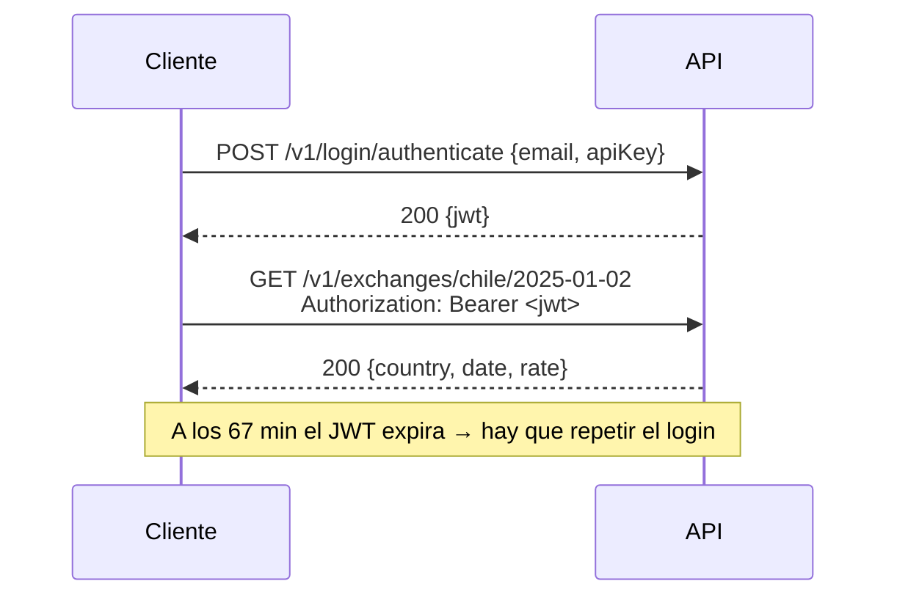

# Referencia de la API

Todas las rutas cuelgan del *context path* `/cpyd`. En local, la URL base es:

```
http://localhost:8080/cpyd
```

Los cuerpos de petición y respuesta usan **JSON** (UTF-8).

---

## 1. Flujo general



1. Se obtiene un **JWT** con el correo y la API key.
2. Ese JWT se envía en cada consulta de datos, en la cabecera `Authorization`.

---

## 2. Autenticación

### `POST /v1/login/authenticate`

Cambia las credenciales por un token.

**Petición**

```http
POST /cpyd/v1/login/authenticate
Content-Type: application/json

{
  "email": "alumno@utem.cl",
  "apiKey": "mi-api-key"
}
```

| Campo | Tipo | Descripción |
|---|---|---|
| `email` | string | Correo registrado y **activo** (no distingue mayúsculas) |
| `apiKey` | string | Clave asociada a ese correo (sí distingue mayúsculas) |

**Respuesta `200 OK`**

```json
{ "jwt": "eyJhbGciOiJIUzI1NiJ9...." }
```

**Errores posibles**

| Código | Cuándo |
|---|---|
| `401 Unauthorized` | Correo inexistente o inactivo, o API key incorrecta |
| `429 Too Many Requests` | Más de 5 intentos fallidos en 15 minutos para ese correo |
| `422 Unprocessable Content` | El servidor no tiene configurada una firma válida (`CPYD_SIGN`) |

> El mensaje de error es el mismo para "correo inexistente" y "clave incorrecta". Es deliberado: no revela qué correos existen.

---

## 3. Consultar tipos de cambio

Todas las rutas de esta sección exigen la cabecera:

```
Authorization: Bearer <jwt>
```

(El prefijo `Bearer` es opcional y no distingue mayúsculas, pero úsalo: es el estándar.)

### `GET /v1/exchanges/{country}/{exchange_date}` — un día

| Parámetro | Ubicación | Descripción |
|---|---|---|
| `country` | ruta | `chile`, `colombia` o `ecuador` |
| `exchange_date` | ruta | Fecha ISO `yyyy-MM-dd` |

```bash
curl -H "Authorization: Bearer $JWT" \
     http://localhost:8080/cpyd/v1/exchanges/chile/2025-01-02
```

**Respuesta `200 OK`**

```json
{
  "country": "Chile",
  "date": "2025-01-02",
  "rate": 995.30
}
```

### `GET /v1/exchanges/{country}` — rango de fechas

| Parámetro | Ubicación | Obligatorio | Descripción |
|---|---|:---:|---|
| `country` | ruta | Sí | `chile`, `colombia` o `ecuador` |
| `start_date` | query | Sí | Fecha inicial (inclusive) |
| `end_date` | query | Sí | Fecha final (inclusive) |

Restricciones: `start_date` ≤ `end_date`, y el rango no puede superar **3660 días** (unos 10 años).

```bash
curl -H "Authorization: Bearer $JWT" \
     "http://localhost:8080/cpyd/v1/exchanges/colombia?start_date=2025-01-01&end_date=2025-01-31"
```

**Respuesta `200 OK`** — un arreglo, una entrada por día con dato:

```json
[
  { "country": "Colombia", "date": "2025-01-02", "rate": 4350.12 },
  { "country": "Colombia", "date": "2025-01-03", "rate": 4361.80 }
]
```

### Significado de los campos

| Campo | Descripción |
|---|---|
| `country` | Nombre del país (`Chile`, `Colombia`, `Ecuador`) |
| `date` | Fecha de la cotización |
| `rate` | Unidades de moneda local por **1 USD**, con 2 decimales. Chile → CLP, Colombia → COP, Ecuador → USD (siempre `1.00`, porque su moneda es el dólar) |

> **Días sin dato.** Yahoo Finance solo publica días hábiles de mercado. Fines de semana y feriados **no tienen registro**: una consulta de un día así devuelve `404`, y una consulta de rango simplemente no incluye esas fechas.

---

## 4. Formato de errores

Todos los errores usan el estándar **RFC 7807 (`ProblemDetail`)**:

```json
{
  "type": "https://developer.mozilla.org/en-US/docs/Web/HTTP/Reference/Status/404",
  "title": "Not Found",
  "status": 404,
  "detail": "No hay datos para las fecha y el país indicado",
  "instance": "/cpyd/v1/exchanges/chile/2025-01-04",
  "timestamp": "2025-11-13T15:02:11.532Z",
  "method": "GET",
  "query": "…"
}
```

`query` solo aparece si la petición tenía parámetros de consulta.

### Tabla de códigos

| Código | Causa típica |
|---|---|
| `400 Bad Request` | País no soportado; fecha mal escrita; falta `start_date`/`end_date` o la cabecera `Authorization`; `start_date` > `end_date`; rango mayor a 3660 días |
| `401 Unauthorized` | Falló el login (correo o API key) |
| `403 Forbidden` | JWT ausente, mal formado, con firma inválida, **expirado**, de una credencial inexistente o **desactivada** |
| `404 Not Found` | No hay datos para ese país y fecha(s) |
| `422 Unprocessable Content` | Error de configuración del servidor (p. ej. firma vacía) |
| `429 Too Many Requests` | Demasiados logins fallidos |
| `500 Internal Server Error` | Error inesperado; el mensaje es genérico a propósito |

---

## 5. Endpoints de apoyo

| Ruta | Descripción |
|---|---|
| `/cpyd/actuator/health` | Estado de la aplicación (único endpoint de actuator expuesto por defecto) |
| `/cpyd/swagger-ui/index.html` | Interfaz interactiva de OpenAPI |
| `/cpyd/v3/api-docs` | Especificación OpenAPI en JSON |

---

## 6. Detalles que conviene saber

- **El JWT dura 67 minutos.** Un cliente de larga duración debe volver a autenticarse (por ejemplo, al recibir un `403`).
- **Ecuador siempre vale `1.00`.** Está dolarizado; se incluye para que los tres países tengan las mismas fechas.
- **No hay paginación.** Por eso existe el tope de 3660 días.
- **Los cambios de credenciales no son instantáneos.** Las credenciales se guardan en caché (mínimo 17 minutos); activar o desactivar un usuario puede tardar en reflejarse. Ver [`ARQUITECTURA.md`](ARQUITECTURA.md#4-caché).
