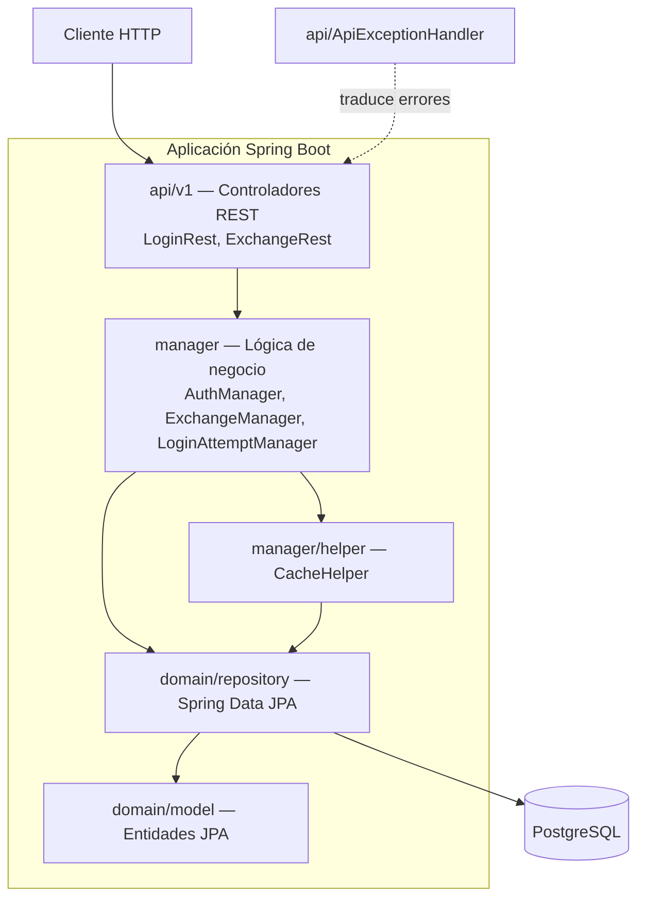
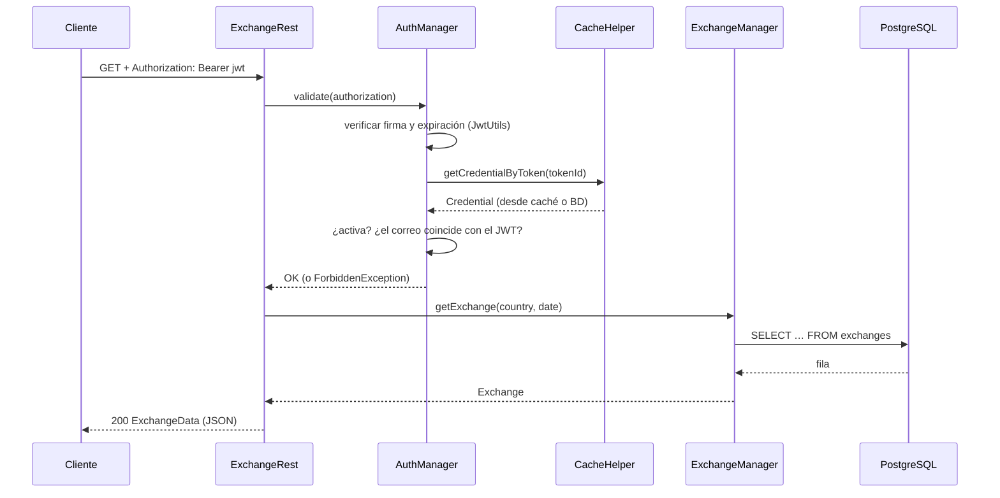

# Arquitectura

Este documento explica **cómo está construida** la aplicación y **por qué** se tomaron ciertas decisiones. Está pensado para leerse con el código abierto.

Paquete raíz: `cl.utem.inf.cpyd` (en `app/src/main/java/`).

---

## 1. Visión por capas

Cada capa solo conoce a la de abajo. Esa regla permite probar cada pieza de forma aislada (ver [`PRUEBAS.md`](PRUEBAS.md)).

| Paquete | Responsabilidad |
|---|---|
| `api` / `api/v1` | Recibir peticiones HTTP, validar parámetros, devolver respuestas. **No** contienen reglas de negocio |
| `manager` | Reglas de negocio: autenticar, consultar cambios, limitar intentos |
| `manager/helper` | `CacheHelper`: acceso cacheado a credenciales |
| `domain/model` | Entidades JPA (`Credential`, `Exchange`) y la base `PkEntityBase` |
| `domain/repository` | Interfaces de Spring Data; las consultas se generan o se declaran con `@Query` |
| `domain/data` | DTOs: objetos que viajan en JSON (`LoginRequest`, `LoginResponse`, `ExchangeData`) |
| `domain/enums` | `Country` y su convertidor a base de datos |
| `domain/utils` | Utilidades de entidades y reloj de auditoría |
| `conf` | Configuración (`CacheConf`) |
| `exceptions` | Excepciones propias de la aplicación |
| `utils` | `JwtUtils`, `TextUtils`, `UuidUtils` |

---

## 2. Flujo de una petición

Ejemplo: `GET /cpyd/v1/exchanges/chile/2025-01-02`.

Puntos a notar:

1. **No hay Spring Security ni filtros.** Cada método de controlador llama explícitamente a `authManager.validate(...)`. Si agregas un endpoint protegido y olvidas esa línea, quedará abierto.
2. El controlador convierte el texto del país (`"chile"`) en el enum `Country` (`ExchangeRest.convert`).
3. Si no hay datos, se lanza `NoDataException`, que el manejador convierte en `404`.

---

## 3. Modelo de dominio

- **`PkEntityBase`** (`@MappedSuperclass`): aporta `id` (autoincremental), `created` y `updated`. Estos dos últimos se llenan solos con `@PrePersist` / `@PreUpdate` usando `AuditClock` (siempre en UTC).
- **`Exchange`**: país + fecha + tasa. Su `equals`/`hashCode` se basan en `(country, date)`, que es su clave natural.
- **`Credential`**: correo, API key, `token` (UUID) y bandera `active`.
- **`Country`**: `CHILE(0)`, `COLOMBIA(1)`, `ECUADOR(2)`, con código ISO, nombre y moneda. El número se guarda en la columna `smallint` mediante `CountryConverter`.

> **Decisión de diseño:** se guarda un *id explícito* y no el ordinal del enum (la posición en que está declarado). Así, reordenar o insertar valores en el enum no corrompe la base de datos.

---

## 4. Caché

**Problema:** cada petición necesita verificar la credencial del usuario. Consultar la base de datos cada vez sería lento e innecesario, porque las credenciales casi no cambian.

**Solución:** una caché local con **Caffeine**, configurada en `CacheConf`:

| Parámetro | Valor |
|---|---|
| Expiración | 17 minutos desde la escritura (mínimo permitido; propiedad `api.cache.expires.minutes`) |
| Tamaño máximo | 100 entradas por caché (mínimo; propiedad `api.cache.pool.size`) |
| Estadísticas | Activadas (`recordStats`) |

`CacheHelper` define tres cachés:

| Caché | Guarda | Clave |
|---|---|---|
| `active-emails` | Conjunto de correos activos | (única) |
| `credential-by-token` | Credencial | UUID del token |
| `credential-by-email` | Credencial | Correo |

### ¿Por qué `CacheHelper` y no anotar `AuthManager`?

Spring implementa `@Cacheable` con un *proxy* que envuelve al objeto. El proxy solo interviene cuando la llamada **entra desde otro objeto**. Si un método de `AuthManager` llamara a otro método anotado *de la misma clase*, esa llamada interna se saltaría la caché. Poner las anotaciones en una clase aparte garantiza que toda llamada cruce el proxy.

### Consecuencias que debes conocer

- **Datos desactualizados:** activar o desactivar un usuario puede tardar hasta 17 minutos en notarse. Existe `CacheHelper.clearActiveEmailsCache()` para vaciar las cachés, pero ningún flujo de la aplicación lo invoca todavía.
- **Los resultados vacíos no se guardan** (`unless = "#result == null"`), de modo que una credencial recién creada se reconoce de inmediato.
- Para esas dos cachés se desactivó `sync = true` (incompatible con `unless`). Es un compromiso: se pierde la protección contra *cache stampede* (muchos hilos pidiendo a la vez un dato recién expirado).

---

## 5. Manejo de errores

Las excepciones propias viven en `exceptions/` y `ApiExceptionHandler` (`@RestControllerAdvice`) las traduce a respuestas HTTP con formato `ProblemDetail`:

| Excepción | HTTP |
|---|---|
| `ValidationException` | 400 |
| `AuthException` | 401 |
| `ForbiddenException` | 403 |
| `NoDataException` | 404 |
| `UtemException` | 422 |
| `TooManyRequestsException` | 429 |
| cualquier otra | 500 (mensaje genérico) |

`ApiExceptionHandler` además extiende `ResponseEntityExceptionHandler`, de modo que los errores que detecta el propio framework (cabecera ausente, parámetro mal tipado, método no permitido…) devuelven un `4xx` y no un `500`.

**Idea clave:** el controlador *lanza* excepciones con significado de negocio y no decide códigos HTTP. Esa traducción está en un solo lugar.

---

## 6. Configuración

Archivo: `app/src/main/resources/application.properties`. Los valores sensibles se leen de **variables de entorno**:

| Variable | Propiedad | Descripción |
|---|---|---|
| `CPYD_SIGN` | `cpyd.sign` | Clave de firma del JWT. **Obligatoria**, mínimo 32 bytes |
| `CPYD_DB_URL` | `spring.datasource.url` | URL JDBC |
| `CPYD_DB_USER` | `spring.datasource.username` | Usuario de BD |
| `CPYD_DB_PASSWORD` | `spring.datasource.password` | Clave de BD |
| `CPYD_LOG_LEVEL` | `logging.level.cl.utem.inf.cpyd` | Nivel de log (por defecto `INFO`) |
| — | `cpyd.login.max-attempts` | Fallos de login permitidos (5) |
| — | `cpyd.login.window.minutes` | Ventana de conteo en minutos (15) |
| — | `server.servlet.context-path` | Prefijo de rutas (`/cpyd`) |

---

## 7. Empaquetado

El proyecto genera un **WAR** (`cpyd.war`, por `<finalName>cpyd</finalName>`). Tomcat se declara como dependencia `provided`: sirve para desplegar en un Tomcat externo. Con `./mvnw spring-boot:run` se ejecuta igualmente con un servidor embebido.

---

## 8. Decisiones de diseño y sus compromisos

| Decisión | Beneficio | Costo |
|---|---|---|
| Autenticación manual en cada controlador | Código simple y fácil de seguir | Fácil olvidarla en un endpoint nuevo |
| Caché local en memoria (Caffeine) | Sin servicios externos, muy rápida | No se comparte entre varias instancias de la API |
| Límite de intentos en memoria | Sin dependencias | Se reinicia al reiniciar la app; cada instancia cuenta por separado |
| JWT sin estado | El servidor no guarda sesiones | No se puede revocar un token antes de que expire (se mitiga comprobando `active`) |
| Datos cargados fuera de la API | API de solo lectura, más simple | Hay un paso manual de carga |
