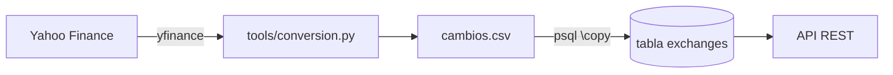

# Base de datos

La API guarda sus datos en **PostgreSQL**. El esquema vive en [`db/01-model.sql`](../db/01-model.sql).

> **Importante:** la aplicación **no crea las tablas por sí sola** (no usa `ddl-auto` fuera de las pruebas). Debes ejecutar el script a mano.

---

## 1. Modelo de datos

```mermaid
erDiagram
    CREDENTIALS {
        bigint pk PK
        uuid token UK
        varchar email UK
        varchar api_key
        boolean active
        timestamptz created
        timestamptz updated
    }
    EXCHANGES {
        bigint pk PK
        smallint ex_country
        date ex_date
        numeric ex_rate
        timestamptz created
        timestamptz updated
    }
```

Las dos tablas **no se relacionan entre sí**: `credentials` solo sirve para autenticar y `exchanges` contiene los datos.

### Tabla `credentials`

| Columna | Tipo | Descripción |
|---|---|---|
| `pk` | `bigint` identidad | Identificador autoincremental |
| `token` | `uuid` único | Identificador interno de la credencial; viaja **dentro del JWT** (claim `tokenId`) |
| `email` | `varchar(255)` | Correo del usuario. Índice único sobre `UPPER(email)`: no pueden existir dos correos que difieran solo en mayúsculas |
| `api_key` | `varchar(255)` | Clave secreta del usuario |
| `active` | `boolean`, por defecto `TRUE` | Si es `FALSE`, el usuario no puede iniciar sesión ni usar su JWT |
| `created`, `updated` | `timestamptz` | Auditoría; las llena la aplicación (en UTC) |

### Tabla `exchanges`

| Columna | Tipo | Descripción |
|---|---|---|
| `pk` | `bigint` identidad | Identificador autoincremental |
| `ex_country` | `smallint` | País codificado: **0 = Chile, 1 = Colombia, 2 = Ecuador** |
| `ex_date` | `date` | Fecha de la cotización |
| `ex_rate` | `numeric(17,2)` | Unidades de moneda local por 1 USD |
| `created`, `updated` | `timestamptz` | Auditoría |

Índices: uno por `ex_country`, uno por `ex_date` y un **índice único `(ex_country, ex_date)`** que impide duplicar un día para un mismo país.

> **Código de país estable.** Los números 0, 1 y 2 están fijados en el enum `Country` (método `getId()`) y los traduce `CountryConverter`. No los reordenes: cambiarlos corrompería los datos ya cargados.

---

## 2. Crear la base de datos

La configuración por defecto espera una base `exchangesdb` y el usuario `utem` con clave `utem`:

```bash
# Como superusuario de PostgreSQL
sudo -u postgres psql <<'SQL'
CREATE USER utem WITH PASSWORD 'utem';
CREATE DATABASE exchangesdb OWNER utem;
SQL

# Crear tablas e índices
psql -U utem -h localhost exchangesdb -f db/01-model.sql
```

> `01-model.sql` empieza con `DROP TABLE IF EXISTS … CASCADE`: **borra los datos** si lo vuelves a ejecutar.

Si usas otros valores, indícalos con variables de entorno:

| Variable | Valor por defecto |
|---|---|
| `CPYD_DB_URL` | `jdbc:postgresql:exchangesdb` |
| `CPYD_DB_USER` | `utem` |
| `CPYD_DB_PASSWORD` | `utem` |

Si ya tenías una base creada con una versión anterior del script (sin la columna `active`):

```sql
ALTER TABLE credentials ADD COLUMN active boolean NOT NULL DEFAULT TRUE;
```

---

## 3. Generar y cargar los datos de tipo de cambio

La API **no descarga datos por sí misma**. El flujo es:



### 3.1 Generar el CSV

```bash
cd tools
python3 -m venv venv && source venv/bin/activate
pip install yfinance pandas

python conversion.py --start 2025-01-01 --end 2025-12-31 --output cambios.csv
```

| Argumento | Descripción |
|---|---|
| `--start` | Fecha de inicio `YYYY-MM-DD` |
| `--end` | Fecha de término `YYYY-MM-DD` (yfinance la trata como **exclusiva**) |
| `--output` | Ruta del CSV de salida |

El script descarga los tickers `CLP=X` (Chile) y `COP=X` (Colombia), toma el precio de cierre diario y **agrega Ecuador con valor fijo `1.00`** en las mismas fechas. Termina con código `0` si todo fue bien y `1` si hubo un error.

Formato del CSV generado:

```csv
País,Fecha,Cambio_USD
Chile,2025-01-02,995.3
Colombia,2025-01-02,4350.12
Ecuador,2025-01-02,1.0
```

### 3.2 Cargar el CSV en PostgreSQL

Se usa una tabla temporal de paso y luego se traduce el nombre del país a su código:

```sql
-- Dentro de psql, conectado a exchangesdb
CREATE TEMP TABLE staging (pais text, fecha date, cambio numeric);

\copy staging FROM 'tools/cambios.csv' WITH (FORMAT csv, HEADER true)

INSERT INTO exchanges (ex_country, ex_date, ex_rate)
SELECT CASE pais WHEN 'Chile'    THEN 0
                 WHEN 'Colombia' THEN 1
                 WHEN 'Ecuador'  THEN 2 END,
       fecha,
       ROUND(cambio, 2)
FROM staging
ON CONFLICT (ex_country, ex_date)
DO UPDATE SET ex_rate = EXCLUDED.ex_rate, updated = NOW();
```

`ON CONFLICT … DO UPDATE` permite recargar el mismo rango de fechas sin errores por duplicados.

Verificación rápida:

```sql
SELECT ex_country, COUNT(*), MIN(ex_date), MAX(ex_date) FROM exchanges GROUP BY ex_country;
```

---

## 4. Crear una credencial de acceso

No existe un endpoint para registrar usuarios; las credenciales se insertan directamente:

```sql
INSERT INTO credentials (token, email, api_key)
VALUES (gen_random_uuid(), 'alumno@utem.cl', 'una-clave-larga-y-secreta');
```

- `token` debe ser un UUID **único**; `gen_random_uuid()` está disponible desde PostgreSQL 13.
- `active` queda en `TRUE` por defecto.
- Para **desactivar** a un usuario: `UPDATE credentials SET active = FALSE WHERE email = '…';` (puede tardar en surtir efecto por la caché).

> **Limitación conocida:** la `api_key` se guarda en **texto plano**. Es aceptable para un taller, pero en un sistema real debería almacenarse como *hash* (ver [`SEGURIDAD.md`](SEGURIDAD.md)).

---

## 5. Base de datos en las pruebas

Las pruebas **no usan PostgreSQL**: emplean **H2 en memoria** en modo compatible con PostgreSQL, y Hibernate crea las tablas automáticamente (`ddl-auto=create-drop`). Así las pruebas no dependen de ningún servicio externo. Consecuencia: **un error en `01-model.sql` no lo detectan las pruebas**, por eso conviene revisar el script a mano cuando cambie el modelo.
