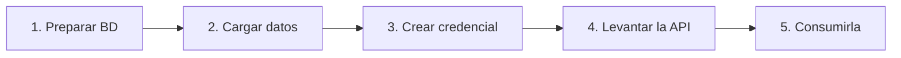

# Guía del estudiante

Esta guía te lleva desde cero hasta consumir la API. Los ejercicios finales son **propuestas de trabajo**; ajústalos a lo que indique tu profesor.

---

## 1. Qué vas a hacer



---

## 2. Requisitos

| Herramienta | Para qué | Comprobar |
|---|---|---|
| Java 25 (JDK) | Ejecutar la API | `java -version` |
| PostgreSQL | Base de datos | `psql --version` |
| Python 3 | Generar datos (opcional) | `python3 --version` |
| `curl` | Probar la API | `curl --version` |

No necesitas instalar Maven: el proyecto incluye `mvnw`.

---

## 3. Paso a paso

### Paso 1 — Crear la base de datos

```bash
sudo -u postgres psql <<'SQL'
CREATE USER utem WITH PASSWORD 'utem';
CREATE DATABASE exchangesdb OWNER utem;
SQL

psql -U utem -h localhost exchangesdb -f db/01-model.sql
```

### Paso 2 — Cargar datos

Genera el CSV y cárgalo siguiendo la sección 3 de [`BASE_DE_DATOS.md`](BASE_DE_DATOS.md#3-generar-y-cargar-los-datos-de-tipo-de-cambio).

### Paso 3 — Crear tu credencial

```sql
INSERT INTO credentials (token, email, api_key)
VALUES (gen_random_uuid(), 'tu.correo@utem.cl', 'una-clave-larga-y-secreta');
```

### Paso 4 — Levantar la API

```bash
export CPYD_SIGN="una-clave-secreta-de-al-menos-32-caracteres"
cd app
./mvnw spring-boot:run
```

Si olvidas `CPYD_SIGN`, la API arranca pero el login responde `422`.

Comprueba: `curl http://localhost:8080/cpyd/actuator/health` → `{"status":"UP"}`.

### Paso 5 — Probar con curl

```bash
BASE=http://localhost:8080/cpyd

# a) Obtener el token
JWT=$(curl -s -X POST $BASE/v1/login/authenticate \
  -H 'Content-Type: application/json' \
  -d '{"email":"tu.correo@utem.cl","apiKey":"una-clave-larga-y-secreta"}' \
  | python3 -c 'import sys,json; print(json.load(sys.stdin)["jwt"])')

# b) Consultar un día
curl -H "Authorization: Bearer $JWT" $BASE/v1/exchanges/chile/2025-01-02

# c) Consultar un rango
curl -H "Authorization: Bearer $JWT" \
  "$BASE/v1/exchanges/colombia?start_date=2025-01-01&end_date=2025-01-31"
```

También puedes probar desde el navegador en `http://localhost:8080/cpyd/swagger-ui/index.html`:

1. Despliegue **Autenticación → `POST /v1/login/authenticate`**, pulse *Try it out*, cambie el cuerpo por su correo y API key y pulse *Execute*.
2. Copie el valor de `jwt` de la respuesta.
3. Pulse **Authorize** (arriba a la derecha), pegue el token en `bearerAuth` y confirme. No escriba la palabra `Bearer`.
4. Ejecute cualquier endpoint de **Tipos de cambio**: el token se envía solo. Si ve un `403`, el token expiró (67 minutos): repita el paso 1.

---

## 4. Ejemplos de cliente

### Python (sin dependencias externas)

```python
import json, os, urllib.request

BASE = "http://localhost:8080/cpyd"

def login(email, api_key):
    req = urllib.request.Request(
        f"{BASE}/v1/login/authenticate",
        data=json.dumps({"email": email, "apiKey": api_key}).encode(),
        headers={"Content-Type": "application/json"},
    )
    with urllib.request.urlopen(req) as r:
        return json.load(r)["jwt"]

def rango(jwt, pais, inicio, fin):
    url = f"{BASE}/v1/exchanges/{pais}?start_date={inicio}&end_date={fin}"
    req = urllib.request.Request(url, headers={"Authorization": f"Bearer {jwt}"})
    with urllib.request.urlopen(req) as r:
        return json.load(r)

jwt = login(os.environ["CPYD_EMAIL"], os.environ["CPYD_API_KEY"])
for fila in rango(jwt, "chile", "2025-01-01", "2025-01-31"):
    print(fila["date"], fila["rate"])
```

### Java (cliente HTTP estándar)

```java
import java.net.URI;
import java.net.http.*;

HttpClient http = HttpClient.newHttpClient();

HttpRequest req = HttpRequest.newBuilder()
    .uri(URI.create("http://localhost:8080/cpyd/v1/exchanges/chile/2025-01-02"))
    .header("Authorization", "Bearer " + jwt)
    .GET().build();

HttpResponse<String> res = http.send(req, HttpResponse.BodyHandlers.ofString());
System.out.println(res.statusCode() + " " + res.body());
```

---

## 5. Cómo leer los errores

| Ves | Significa | Qué hacer |
|---|---|---|
| `401` en el login | Correo o clave incorrectos | Revisa tus datos; ojo con el límite de 5 intentos |
| `429` en el login | Superaste los intentos | Espera 15 minutos |
| `403` en una consulta | Token ausente, inválido, expirado o usuario desactivado | Vuelve a hacer login (una sola vez) |
| `400` | Petición mal formada | Mira el campo `detail` de la respuesta |
| `404` | No hay dato para esa fecha | Probablemente fin de semana o feriado |
| `422` en el login | Servidor sin `CPYD_SIGN` | Define la variable y reinicia |
| Error de conexión | La API no está levantada | Revisa el Paso 4 |

El campo `detail` de cada error explica la causa.

---

## 6. Ejercicios propuestos

### Nivel 1 — Familiarización

1. Obtén un JWT y **decodifícalo** en <https://jwt.io>. Identifica `sub`, `exp` y `tokenId`. ¿Cuántos minutos hay entre `iat` y `exp`?
2. Consulta la misma fecha para los tres países y compara los valores. ¿Por qué Ecuador siempre da `1.00`?
3. Consulta un sábado. ¿Qué código recibes y por qué?
4. Provoca a propósito un `400`, un `403` y un `404`, y anota qué los causó.

### Nivel 2 — Cliente secuencial

5. Escribe un programa que obtenga el tipo de cambio de **un año completo** de Chile y calcule promedio, mínimo y máximo.
6. Haz que, ante un `403`, el programa renueve el token **una sola vez** y reintente.
7. Mide cuánto tarda en total.

### Nivel 3 — Concurrencia y paralelismo

8. Divide un año en **12 rangos mensuales** y consúltalos con varios hilos. Compara el tiempo con el ejercicio 7.
9. Repite con los **tres países** a la vez. ¿Cuántas peticiones simultáneas conviene hacer? Mide con 1, 2, 4, 8 y 16 hilos y grafica el resultado.
10. ¿Qué ocurre si cada hilo hace su propio login? Considera el límite de intentos y el costo de repetir un trabajo innecesario. ¿Cómo **compartirías** un único token entre hilos de forma segura?
11. Cuando el token expira a mitad de la ejecución, varios hilos recibirán `403` casi a la vez. Diseña cómo evitar que **todos** vuelvan a hacer login (pista: solo uno debe renovar, los demás esperan).

### Nivel 4 — Análisis crítico

12. Lee [`SEGURIDAD.md`](SEGURIDAD.md#5-limitaciones-conocidas-ejercicio-de-análisis) y elige **dos** limitaciones. Para cada una, explica el riesgo y propón e implementa una mejora.
13. La caché guarda credenciales ≥ 17 minutos. Diseña una prueba que demuestre el retraso al desactivar un usuario y propón cómo corregirlo.
14. Mide con cuántas peticiones por segundo empieza a degradarse la API. ¿Qué parte del sistema es el cuello de botella: la aplicación, la base de datos o tu cliente?

---

## 7. Preguntas frecuentes

**¿Por qué mi consulta de rango devuelve menos días de los que pedí?**
Solo existen días hábiles de mercado. Ver [`API.md`](API.md#3-consultar-tipos-de-cambio).

**¿Puedo usar la API sin PostgreSQL?**
No para ejecutarla, pero sí para ejecutar las pruebas (`./mvnw test` usa H2).

**¿Dónde veo qué hace la API por dentro?**
Sube el nivel de log: `export CPYD_LOG_LEVEL=DEBUG` y reinicia.

**Olvidé mi API key.**
Está en la tabla `credentials`; consúltala con `SELECT email, api_key FROM credentials;`.

**¿Puedo modificar el código?**
Sí. Antes de cambiar algo, lee [`ARQUITECTURA.md`](ARQUITECTURA.md) y ejecuta `./mvnw test` antes y después.
