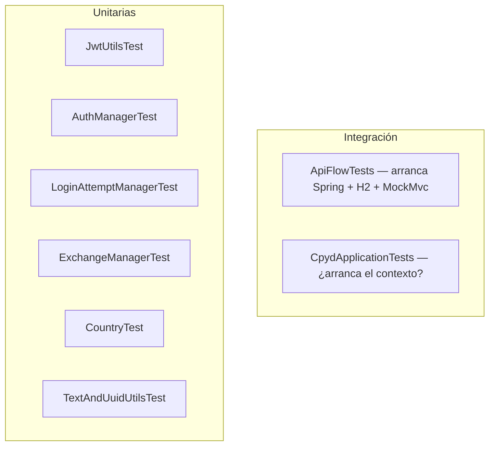

# Pruebas

El proyecto usa **JUnit 5**, **Mockito** y **MockMvc** (incluidos en los *starters* de pruebas de Spring Boot).

---

## 1. Cómo ejecutarlas

Desde el directorio `app/`:

```bash
./mvnw test                                        # todas
./mvnw test -Dtest=JwtUtilsTest                    # una clase
./mvnw test -Dtest=AuthManagerTest#validateAcceptsValidBearer   # un método
```

No hace falta PostgreSQL: las pruebas usan **H2 en memoria** (configurado en `app/src/test/resources/application.properties`) y una clave de firma de prueba.

---

## 2. Dos niveles de prueba



| | Unitarias | De integración |
|---|---|---|
| Qué prueban | Una clase aislada | Varias capas juntas |
| Dependencias | Simuladas con Mockito | Reales (H2, Spring) |
| Velocidad | Milisegundos | Segundos |
| Detectan | Errores de lógica | Errores de configuración y de conexión entre piezas |

Ambos niveles se complementan. Por ejemplo, el error de los nombres de caché solo lo detecta una prueba de integración: las unitarias, que simulan `CacheHelper`, nunca lo verían.

---

## 3. Qué cubre cada clase

| Clase | Qué verifica |
|---|---|
| `JwtUtilsTest` | Ida y vuelta de un JWT; entradas inválidas; firma incorrecta; token mal formado; token expirado; unicidad del `jti` |
| `AuthManagerTest` | `isValid`; comparación de API key; `validate` con Bearer válido, header vacío, token desconocido, credencial inactiva, correo distinto y basura |
| `LoginAttemptManagerTest` | Bloqueo tras N fallos; claves independientes; `reset`; valores mínimos de configuración |
| `ExchangeManagerTest` | Argumentos nulos no consultan el repositorio; delegación correcta |
| `CountryTest` | Ids 0/1/2 estables; `fromId`; `CountryConverter` con nulos |
| `TextAndUuidUtilsTest` | Normalización y escape de texto; UUID versión 7 |
| `ApiFlowTests` | Login + consulta de punta a punta; clave incorrecta → 401; credencial inactiva → 403; sin cabecera → 400; fecha inválida → 400; rango invertido → 400; consulta de rango; bloqueo → 429 |
| `CpydApplicationTests` | El contexto de Spring arranca |

---

## 4. Técnicas usadas (para aprender)

**Simulación con Mockito** (`AuthManagerTest`). En vez de usar la caché y la base reales, se crea un `CacheHelper` falso y se le indica qué devolver:

```java
cache = mock(CacheHelper.class);
when(cache.getCredentialByToken(token)).thenReturn(Optional.of(cred));
```

**Peticiones HTTP simuladas con MockMvc** (`ApiFlowTests`). Se ejerce el controlador completo sin abrir un puerto de red:

```java
mvc.perform(get("/v1/exchanges/chile/2025-01-02")
        .header("Authorization", bearer))
   .andExpect(status().isOk())
   .andExpect(jsonPath("$.rate").value(980.50));
```

**Datos de prueba propios.** `ApiFlowTests` inserta sus credenciales y cotizaciones antes de empezar (`@BeforeAll`), de modo que no depende de datos externos.

---

## 5. Limitaciones de la batería actual

- `CacheHelper`, `ExchangeRest` y `ApiExceptionHandler` se prueban **solo de forma indirecta** (a través de `ApiFlowTests`).
- H2 no es PostgreSQL: **no se valida `db/01-model.sql`**.
- No hay pruebas de carga ni de concurrencia, algo especialmente relevante para un curso de computación paralela.

---

## 6. Cómo agregar una prueba

1. Ubícala en el mismo paquete que la clase probada, bajo `app/src/test/java/…`, con el sufijo `Test` (o `Tests`).
2. Si la clase depende de otras, simúlalas con `mock(...)`.
3. Usa nombres que describan el comportamiento: `validateRejectsInactiveCredential`.
4. Prueba tanto el caso feliz como los casos de error.
5. Ejecuta `./mvnw test` antes de entregar.
