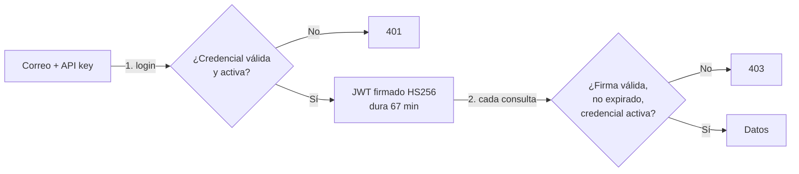

# Seguridad

Este documento describe **cómo se protege la API** y, con la misma importancia, **qué no protege**. Reconocer las limitaciones de un diseño es parte del análisis académico.

---

## 1. Visión general



Dos conceptos distintos:

| Concepto | Qué es | Dura |
|---|---|---|
| **API key** | Secreto de largo plazo, guardado en la BD | Hasta que se cambie |
| **JWT** | Pase temporal que se obtiene con la API key | 67 minutos |

La idea es enviar la API key **una sola vez** (en el login) y usar después el JWT, que caduca solo.

---

## 2. El JWT

Un JWT (*JSON Web Token*) tiene tres partes separadas por puntos: `cabecera.contenido.firma`, cada una en Base64URL. Puedes pegar uno en <https://jwt.io> para verlo.

### Cabecera

```json
{ "alg": "HS256" }
```

**HS256** firma con HMAC-SHA256 usando una clave compartida (`CPYD_SIGN`). Por eso se exigen **32 bytes como mínimo** (256 bits).

### Contenido (*claims*)

| Claim | Valor | Para qué |
|---|---|---|
| `iss` | `api.sebastian.cl` | Quién emitió el token |
| `sub` | correo del usuario | A quién pertenece |
| `iat` | fecha de emisión | — |
| `exp` | emisión + 67 min | Cuándo deja de valer |
| `jti` | UUID versión 7 | Identificador único de ese token |
| `tokenId` | UUID de la credencial | Enlaza el token con la fila de `credentials` |

> **¿Por qué 67 minutos?** Es deliberado: evita coincidir exactamente con ventanas de 60 minutos de invalidación de caché.

### Qué se verifica en cada consulta (`AuthManager.validate`)

1. La cabecera `Authorization` existe; se le quita el prefijo `Bearer`.
2. La **firma** es válida (nadie alteró el contenido).
3. El token **no ha expirado**.
4. Existe el claim `tokenId` y es un UUID.
5. Hay una credencial con ese `tokenId`.
6. La credencial está **activa**.
7. El correo de la credencial coincide con el `sub` del JWT.

Cualquier fallo produce `403 Forbidden`.

### Lo que el JWT **no** hace

- **No está cifrado**, solo firmado. Cualquiera que lo vea puede leer su contenido. Nunca pongas secretos dentro.
- **No se puede revocar** antes de expirar. La mitigación aquí es comprobar `active` en cada consulta (con el retraso de la caché).

---

## 3. Protección contra fuerza bruta

`LoginAttemptManager` cuenta los intentos fallidos **por correo**:

- Máximo **5 fallos** en **15 minutos** (configurable).
- Al superarlo, responde `429 Too Many Requests` aunque la clave sea correcta, hasta que expire la ventana.
- Un login exitoso reinicia el contador.

Se cuenta por correo y no por dirección IP: un atacante puede probar claves contra un correo ajeno y bloquear al usuario legítimo (*denegación de servicio dirigida*). Es un compromiso conocido.

---

## 4. Otras medidas

| Medida | Dónde | Efecto |
|---|---|---|
| Comparación de API key en **tiempo constante** | `AuthManager.isValidApiKey` | Evita deducir la clave midiendo cuánto tarda la respuesta (*timing attack*) |
| Mensaje de login idéntico ante cualquier fallo | `LoginRest` | No revela qué correos existen |
| `500` con mensaje genérico | `ApiExceptionHandler` | No filtra detalles internos |
| Escape de texto en logs | `TextUtils.sanitize`, `StringEscapeUtils` | Evita falsificar líneas de log (*log injection*) |
| Tope de 3660 días por consulta | `ExchangeRest` | Evita consultas sin límite |
| Secretos fuera del código | Variables `CPYD_*` | La firma y las claves de BD no viven en el repositorio |

---

## 5. Limitaciones conocidas (ejercicio de análisis)

Estas **no son errores ocultos**: son compromisos aceptados para un proyecto de taller. Un sistema real debería resolverlas.

| Limitación | Riesgo | Mejora posible |
|---|---|---|
| La `api_key` está en **texto plano** en la BD | Si se filtra la base, se filtran todas las claves | Guardar un *hash* con sal (p. ej. BCrypt o Argon2) |
| Sin HTTPS dentro de la aplicación | Token y clave viajan legibles por la red | Terminar TLS en un proxy inverso o en Tomcat |
| Sin límite de peticiones en rutas de datos | Un cliente puede saturar la API | Limitar por token o IP (p. ej. con un proxy) |
| Límite de login solo en memoria | Se pierde al reiniciar; no se comparte entre instancias | Almacenamiento compartido (Redis) |
| Credenciales cacheadas ≥ 17 min | Un usuario desactivado puede seguir entrando un rato | Vaciar la caché al desactivar (`clearActiveEmailsCache`) |
| Una sola clave de firma | Si se filtra, se pueden forjar tokens | Rotación de claves; algoritmo asimétrico (RS256) |
| Autenticación manual por endpoint | Un endpoint nuevo puede quedar sin proteger | Un filtro o Spring Security aplicado globalmente |

---

## 6. Buenas prácticas para tu cliente

- Guarda el JWT **en memoria**, no en archivos ni en el código.
- No imprimas la API key ni el JWT en logs.
- Pasa credenciales por **variables de entorno**, no por constantes en el código fuente.
- Renueva el token al recibir `403`, pero **con un solo reintento**: si vuelve a fallar, el problema es de credenciales y no de expiración.
- No reintentes sin pausa tras un `429`; espera.
